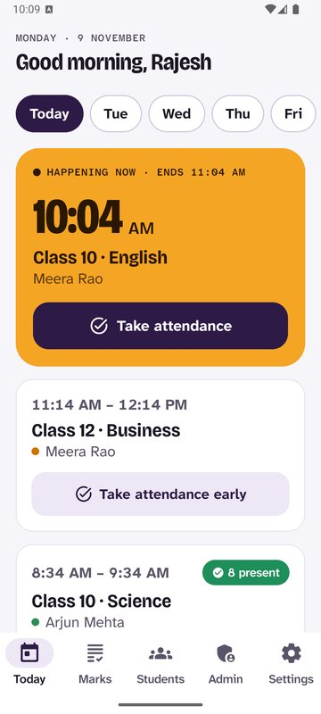
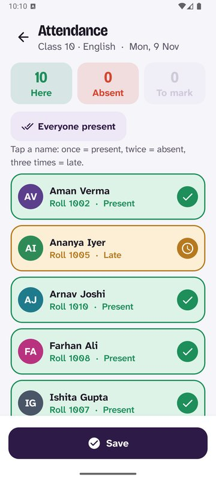
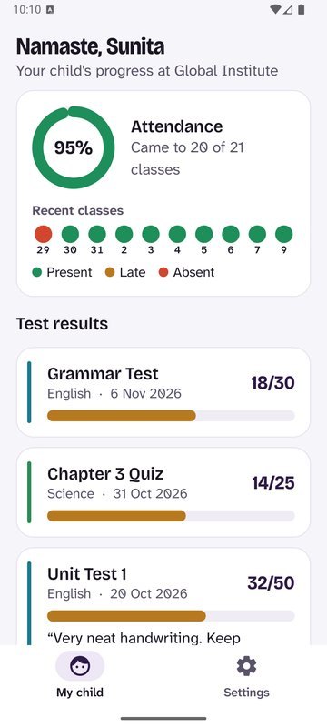
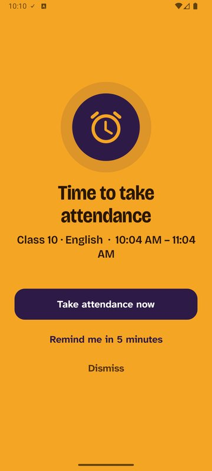

# Akademos

**The Global Institute app.** Teachers take attendance in a few taps, and parents see their child's attendance, marks and answer sheets.

  
  
  
  

---

## Install on your Android phone

### 1. Download

On your phone, tap this link: **[⬇ Download Akademos](https://github.com/farhanakhtar0x66/akademos/releases/latest/download/Akademos.apk)** (about 4 MB)

Or scan this code with your phone camera:

### 2. Install

1. When the download finishes, tap **Open** (or find `Akademos.apk` in your **Downloads** / **Files** app and tap it).
2. Your phone may say *"For your security, your phone is not allowed to install unknown apps from this source."* Tap **Settings**, turn on **Allow from this source**, then press **Back**.
3. Tap **Install**.
4. If you see *"Unsafe app blocked"* or a Play Protect warning, tap **More details → Install anyway**. This appears because the app comes from the institute instead of the Play Store.
5. Tap **Open**. You'll find **Akademos** on your home screen with this icon: a yellow tick on purple.

Needs Android 8 or newer.

### 3. Create your account

1. Tap **New here? Create an account**.
2. Choose a **username** (like `riya.mum`) and a **password** of at least 8 letters and numbers. Write them down somewhere safe.
3. Type your **full name** and the **access key** the institute gave you (it looks like `ABCD-EFGH-JKLM`).
4. Tap **Continue**. That's it.

Each access key works **once**, for **one person**, and stops working after a few days. If yours doesn't work, ask the institute office for a new one. Please don't share your key.

---

## What you can do

| | Parents | Teachers | Administrator |
|---|:---:|:---:|:---:|
| See your child's attendance, marks and answer sheets | ✓ | | |
| Take attendance and mark who leaves | | ✓ | ✓ |
| Enter marks and photograph answer sheets | | ✓ | ✓ |
| Get a full-screen reminder when class starts and ends | | ✓ | ✓ |
| Add students, classes, subjects and the timetable | | | ✓ |
| Invite teachers and parents, block access | | | ✓ |

## For teachers: make sure reminders work

The app wakes your phone with a full-screen alert when a class starts, when it ends, and 15 minutes after attendance if anyone was absent.

1. Open the app. On the **Today** screen, tap **Set up now** and allow everything it asks for.
2. Go to **Settings → Send a test alert** and lock your phone. A yellow alert should appear within 10 seconds.

**On Xiaomi, Redmi, POCO, Oppo, Realme, Vivo, OnePlus or Samsung phones**, the phone's battery saver can block reminders. If the test alert doesn't appear:
- Open the phone's **Settings → Apps → Akademos**.
- Set **Battery** to **Unrestricted** / **No restrictions**.
- Turn on **Autostart** (Xiaomi, Oppo, Vivo, Realme).
- Samsung: in **Settings → Battery → Background usage limits**, make sure Akademos is **not** in "Sleeping apps".

## Updating

When the institute announces a new version, download and install it the same way. Your account and data stay as they are. You don't need to uninstall first.

## Privacy and security

- Parents can only ever see **their own child**. This is enforced by the institute's database, not just the app.
- Only teachers and the administrator can change attendance or marks, and every change is recorded with who made it.
- Teacher accounts lock behind your fingerprint or phone PIN.
- Answer sheets are stored privately and can only be opened by staff and that child's parents.

---

For the people running the server or building the app: see [docs/SETUP.md](docs/SETUP.md).
